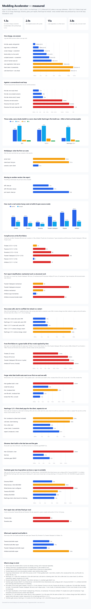

# Modding Accelerator

A fast test loop for Minecraft mods (`modaccel`: Fabric, NeoForge and Forge). Save a file, and a
second or two later you know whether your logic still works - without launching Minecraft, loading a
world, or clicking anything.

Then, when the change is visual or behavioural, the same command swaps your new code into a
client that is **already running** and proves it with pixels or a ticking block, in two to
four seconds. Forge has no hot reload, so it gets the pixels without the swap.

This repo works on day one: it contains a small real mod (an item, a block with a ticking
block entity, an in-game screen and a mixin) plus the tests for all of them. Replace the mod,
keep the loop.

Verified on **Minecraft 26.3 + Fabric** (Loader 0.19.5, Fabric API 0.163.0, Java 25), on
**1.21.11** (same demo, own node), on **NeoForge 1.21.1** (own node, Java 21) and on
**Forge 1.20.1** (MineColonies, built by the pinned JDK 17; no hot reload).

## What this covers, and what it does not

| Loader | Fast lane, warm client, scenarios | Installer | Port tooling |
|---|---|---|---|
| Fabric (Loom) | yes | yes | `-Check`, `-Log`, `diff`, `port` |
| NeoForge (moddev) | yes (own node) | yes | `-Check`, `-Log`, `diff`, `port` |
| Forge / ForgeGradle | yes: fast lane, plus a warm client from one captured launch (no hot reload) | yes (fast lane + bridge) | `-Check`, `-Log`, `diff` |

ForgeGradle repos get the fast lane first - compile plus pure logic tests, without Gradle - and
now the warm client too (below). Measured on MineColonies 1.20.1 (2,102 sources, JDK 17):

| Check | Time |
|---|---|
| `gradlew build -x test` (their own baseline) | 328.3s |
| first `.\modaccel fast` (JUnit fetch, full compile) | 23.9s |
| one-file edit, `.\modaccel fast` | **2.3s** |
| deliberately broken file | FAIL in 1.3s with file and line, exit code 1 |

The warm client is not tied to Loom any more. Each loader gets its own launch, and the client stays
up between checks:

| Loader | Warm client source | Measured |
|---|---|---|
| Fabric | Loom's launch config | screen 1.5s, 7 classes redefined |
| NeoForge | ModDevGradle's generated recipe (no Gradle) | first check 25.6s, screen **3.2s**, hot reload **1.5s**, restart only for added fields/methods |
| Forge 1.20.1 | one captured command (`tools\capture-launch.ps1`) into a Java argfile, replayed with the Forge bridge jar | 854x480 title PNG; cold `ui` **58.6s**, warm **0.5s** |

`install.ps1` wires a Forge repo itself (`labClasspath` block in `build.gradle`, harness copied, no
Fabric files touched) - measured on MineColonies: install 5s, first `fast` 13s including Gradle,
then 1.9s. It also copies the Forge bridge to `.modaccel\bridge-forge.jar`; `modaccel` puts that
jar in the repo's `mods\`, replays `.modaccel\forge.args` and waits for the socket, so the first
`.\modaccel ui` needs no manual step. One capture per Forge repo, and there is no hot reload there:
a code edit means the client starts again (58.6s), while a repeat check against the running client
answers in 0.5s. ForgeGradle rewrites its whole command line on a dependency change, so the
captured launch is re-taken with the same tool after such a change.

A big repo usually stops at its **toolchain** before its code: a Gradle that refuses the JDK, a
NeoGradle newer than the wrapper, or a maven that is down. That is what `port -Check` answers first.



Every number in that picture comes from a run in this repo (`.runs/`); `bench/charts.ps1`
regenerates it from `bench/data.json`. There is an offline HTML version in
`bench/benchmarks.html`.

---

## The old way, and what this changes

How a mod change is normally checked:

1. Edit the code.
2. `./gradlew runClient` and wait 15-25 seconds for the client to reach the title screen.
3. Create or load a world, another 5-15 seconds.
4. Get to the thing: `/give` the item, find the block in creative, craft it, or open the GUI.
5. Look at it, do the action, read the log, decide.
6. Quit the client (it saves), change one line, start again.

That is **one to several minutes per change**, and most of it is waiting. Multiply by every
tiny edit and the afternoon disappears. The alternative most people use - Fabric's GameTest -
still costs a full server boot (15-30s) and gives you no picture at all.

What this lab does instead:

| You changed | You run | You wait |
|---|---|---|
| A recipe, sort order, codec, config rule | `.\modaccel` | **1-3s** - no Minecraft at all |
| A screen: layout, colours, text | `.\modaccel ui` | **1-3s** - a screenshot you can look at |
| A block entity, item behaviour, tick logic | `.\modaccel node` | **2-4s** - real world, real ticker |
| A mixin body | `.\modaccel world` | 13-30s - mixins are applied at start-up and need the server tier |
| A **new** block/item/registry entry | `.\modaccel world` | 15-30s - the registry only exists at start-up |
| A final "does the real game do this" pass | `.\modaccel look` | 30-60s - fresh client, four screenshots |

Nothing appears on your screen during any of this. The client runs detached; the server is
headless.

---

## For agents

The same onboarding lives as a skill at `skills/modding-accelerator/SKILL.md`, and `install.ps1` copies it to
`.claude/skills/modding-accelerator/SKILL.md` in your repo so an agent there finds the loop without being told.

## Install it into your mod (one command)

You do not have to copy code around or read a conversion guide.

```powershell
git clone <this repo> C:\tmp\mod-lab
C:\tmp\mod-lab\install.ps1 -Target C:\path\to\your\mod
```

Then, in your mod repo: `.\modaccel`.

What the installer touches, and nothing else:

- adds `lab.ps1`, `lab.cmd`, `tools/` (the fast lane, the agent, the lint)
- appends **one marked block** to your `build.gradle` (an `// Added by Modding Accelerator. Safe to
  delete as one block.` section with the
  warm-client run config, the game test source set, the JUnit deps and one classpath task).
  Delete that block and everything is exactly as it was.
- creates `src/gametest/` with a starter `@GameTest` you can replace
- copies the onboarding skill to `.claude/skills/modding-accelerator/SKILL.md`
- adds `.modaccel/`, `.runs/`, `.tools/` to `.gitignore`

It never edits your sources, your `fabric.mod.json` or your assets. Running it twice is safe.
Groovy `build.gradle` only for now; Kotlin DSK (`build.gradle.kts`) is refused with a message.

Verified by installing into a fresh `fabric-example-mod` (26.3) clone: `.\modaccel` passed in 1.1s
and `.\modaccel world` in 18.9s with no other edits; the starter `pure` test means the first run
prints `1 passed`, not `0 passed`. The installer also writes an empty `-Dmodlab.screen=` into a repo
with no custom screen, and `LabControl` then opens whatever screen is current instead of failing.

A repo on a Minecraft version other than 26.x still gets the fast lane and the world tier, but the
installer refuses the client bridge and says why: its sources call 26.x client classes, so `ui`,
`node`, `look`, `suite` and `mp` need that socket and stay unavailable until the repo is on 26.x.
A bridge copy an earlier 26.x install left behind is removed.

### Checklist: install into an existing mod

- [ ] Your repo builds today (`.\gradlew build` passes)
- [ ] Run the installer with `-Target` pointing at your repo
- [ ] `.\modaccel` - lint + logic, about a second
- [ ] `.\modaccel world` - proves your registrations and mixins load
- [ ] Add your own `@Tag("pure")` tests and `@GameTest`s as you go
- [ ] For UI checks, point the client test at your screen (see the UI section)

---
## Quick start

**Requirements:** Windows, PowerShell 7 (`winget install Microsoft.PowerShell`), and about
2GB of free disk for the first run.

1. Get the folder and open a terminal in it.
2. Run `.\modaccel`.

The first run downloads the two JDKs it needs (Temurin 25 and JetBrains Runtime 25, about
280MB) into `.tools`, asks Gradle for the Minecraft classpath once, then answers in about two
seconds:

```
PASS  lint      0.7s  lint: 3 registrations, all files present; mixins: 1 mixin, 1 target, 1 member checked, 0 dead
PASS  logic       0s  8 passed
```

That is the setup finished. No environment variables, no IDE, no manual Gradle.

The lint line includes a mixin audit: a `@Shadow` or `@Inject` whose target no longer exists fails
the run instead of applying silently, and the audit costs 0.17s. It found Traveler's Backpack's dead
`@Shadow`.

### First-run checklist

- [ ] PowerShell 7 installed (`$PSVersionTable.PSVersion` shows 7.x)
- [ ] `.\modaccel` passes (it downloads the JDKs on the first run)
- [ ] `.\modaccel stop` works and `.\modaccel doctor` shows a JDK and no running processes
- [ ] `.\modaccel look` once, then look at the four PNGs it prints (nothing to accept or commit)

---

## Commands

| Command | Use it for | Time |
|---|---|---|
| `.\modaccel` | logic and registration/asset/mixin lint | 1-3s |
| `.\modaccel ui` | a screenshot of your screen, plus a real button click | 1-3s |
| `.\modaccel node` | a block entity in a live world, with an exact expected value | 2-4s |
| `.\modaccel world` | new registrations, mixins, assets and lang keys, a fresh headless server | 13-30s |
| `.\modaccel suite` | a file of named cases against one warm client | seconds |
| `.\modaccel look` | a fresh client: four screenshots, including a 1080p one | 30-60s |
| `.\modaccel mp` | a dedicated server, a hidden client, and the same scenario (`-Cold` refuses a server older than the sources) | 4s warm, 60s first run |
| `.\modaccel status` | each lab process: port, pid, how long it has been up | instant |
| `.\modaccel -Version 1.21.11 ui` | the same check on another Minecraft node | 1-5s |
| `.\modaccel port -New <jar> -Apply` | the port report, plus the renames that are safe to apply | 2-3s |
| `.\modaccel restart` | stop, compile, start after a schema change | 49s on NeoForge |
| `.\modaccel all` | every tier, cheapest first | - |
| `.\modaccel watch` | re-run the fast lane on every save | - |
| `.\modaccel doctor` | versions, and what is running | - |
| `.\modaccel logs` | recent runs with timings | - |
| `.\modaccel stop` | stop the resident fast lane and the hidden client | - |

`lab.cmd` runs the same thing from a double-click or a plain `cmd` window.

---

## Scripted scenarios

```
.\modaccel scenario -Steps "place=yourmod:machine|wait=40|assert=energy|screen=yourmod.client.MachineScreen|click=Start|capture=machine-running"
```

Steps: `place=namespace:id`, `wait=<ticks>`, `assert=<method>` (a block entity method that must return > 0), `screen=<class>`, `click=<button label>`, `capture=<name>`, `settle` (waits until two frames 2 ticks apart are identical, 20 tries, then fails rather than save a half-drawn shot). Warm runs are 0.2-3s; the first one pays the client start (8.6s).

### A whole suite in one command

```
scenarios\prismlab.txt
world-node|place=prismlab:prism_node|wait=40|assert=charge|settle|capture=suite-world-node
ui-prism-screen|screen=com.prismlab.client.PrismScreen|click=More shards|settle|capture=suite-ui
```

`.\modaccel suite` runs every line against one warm client, prints PASS/FAIL per case and the total, and exits non-zero if any case failed. Measured: 2 cases in 4.9s warm; the first case in a suite still pays the world load (4.1s).\n\n## The three tricks

**1. A JVM that stays awake for your logic.** A small background program compiles your
sources with `javac` and runs your tests in a fresh class loader. No Gradle start (3-6s), no
Minecraft bootstrap (8-13s). This is why logic checks are a second.

**2. A client that stays awake for your UI and blocks.** One Minecraft client is started once
and left alone, with its window hidden so it never steals focus. Each check recompiles your mod and swaps the changed classes into the running
process, then opens your screen or places your block and answers. JetBrains Runtime's enhanced
redefinition means you can even add a field or a method; mixin method bodies reload too.

**3. Screenshots, not eyeballs.** `modaccel ui` captures the real client's framebuffer at a fixed
854x480 and GUI scale 2, writes two PNGs (before and after a click), and prints their paths. It
takes a baseline of the shot folder first, so it only prints a PNG this run wrote. You
or your agent look at the picture; there is no pixel comparison to maintain, and no golden to
accept.

## Multiplayer

```
.\modaccel mp -Steps "place=yourmod:machine|wait=60|assert=energy|settle|capture=mp-machine"
```

This starts a dedicated server (flat world, offline mode, kept alive by a stdin pipe), a second
hidden client on port 27389 that joins it, and runs the same scenario steps. In multiplayer the
client cannot reach into the server's world, so `place=` sends a `labplace` command and `assert=`
reads what the server actually sent back to this client.

That difference is the point: it caught a real bug in the demo. On 26.3 the default block entity
update tag is empty, so `charge` never reached a client; singleplayer could not see it because the
"server" and client share one object. The fix was overriding `getUpdatePacket()` and
`getUpdateTag()`.

A server or client started before your last edit holds stale classes, so `mp` refuses to reuse one:
it names the changed and start times and tells you to run `.\modaccel mp -Cold`, which stops both
and loads the sources on disk.

Measured: 4.1s warm for a place/wait/assert/settle/capture case (26.3 is about 11s including the
first world join); a first `mp` run pays the server boot (24s) plus the client start (27s).

`mp -Two` adds a second hidden client that reads the same block from its own world, which is the
only way to prove the server sent it to someone who did not place it:

```
PASS mp    12s   placed at -1, -58, 6 | assert charge() = 3 | screenshot mp-first.png
PASS mp2   12s   at -1, -58, 6 | assert charge() = 64 | screenshot mp-second.png
```

The second client costs one cold start (about 200-260s here, because Gradle serialises two run
tasks from the same project) and then answers in about 12s.

`.\modaccel status` answers "what is running" in one shot:

```
lab        C:\...\modding-accelerator
fast lane   down port 49776
mp client   up   port 27389 pid 51692  3m11s   JBR client (mp)
lab server  up   port 25565 pid 29536  3m40s   dedicated server
```

Every long step prints its own `[  24.2s] what it is doing` line, so a command is never silent
while it waits on a port, a build or a game.

## Porting, measured

Six open-source mods (Trinkets, Traverse, Terrestria, Traveler's Backpack, Polymer, Artifacts),
each bumped one Minecraft step (mostly 1.21.5 → 1.21.6), baseline build green first:

| Mod | Baseline build | Bumped build | Compile errors |
|---|---|---|---|
| Trinkets | 321s | 156s | 21 |
| Traverse | 329s | 115s | 68 |
| Terrestria | 142s | 89s | 99 |
| Traveler's Backpack | 335s | 161s | 6 |
| Polymer | 474s | 186s | 8 |
| Artifacts (1.21.1 → 1.21.4) | 568s | 167s | 97 |

When first bumped, every one of the six stopped at its first compiler failure. What dominated was API shape, not the version
number: one Fabric tag-provider removal is 165 of 299 errors, one GUI matrix change is 17 of
Trinkets' 21, and Artifacts' 97 are the 1.21.2 entity render-state refactor (68 hard rewrites).
Error counts are not effort — Terrestria's 99 errors are 3 symbols in 2 files.

Repair time is measured on all six, each driven to a green build and confirmed with a clean
build: **Trinkets 1.15 min** (21 errors), **Polymer 8.6 min** (35 errors across six modules),
**Traverse 68 call sites** (green build 5.9s), **Terrestria 142 call sites** (7.5s), and
**Traveler's Backpack 11 min** (196 errors, four build cycles, 5s final build). What dominated was
Gradle sequencing and reading, not compiling: Traverse and Terrestria were one removed Fabric
method each, while Traveler's Backpack was one getter family (130 of 196 errors were
`CompoundTag.getX` returning `Optional`) plus 20 distinct API facts.

**When the build is red, read the compiler, not the jar.** `port` and `diff` read compiled classes,
and a failed javac writes no class file for the broken sources: against the two repairs above,
SymbolDiff predicted **0 of 21 and 0 of 35** errors. So there is a second lane:

```
.\modaccel port -Log <build.log> [-New <target jar>]
```

It reads javac's own errors, groups them by file and line, names the nearest class in the target jar
and attaches knowledge notes. Measured on the same logs: 21 errors in 3 files (Trinkets) and 8 in 5
(Polymer). The order is: log report, fix, build, then the binary diff to sweep what only appears once
classes exist.

A known port cause can fix itself: `.\modaccel port -Fix -Log <build.log> [-Task <gradle task>] [-Max 5]
[-DryRun] [-Repo <repo>]` applies `knowledge\fixes.json`, rebuilds and repeats until green, one line per
round (rules, replacements, seconds, errors left). Measured on copies: Traverse 68 -> 0 errors in 2 rounds
/ 7.2s; Traveler's Backpack 1 round / 4.0s for 111 getter sites, then stops at the 6 removed classes no
rule covers.

### Can this repo even build at the target?

Before any code work, ask the toolbox:

```
.\modaccel port -Check <repo> [-To <minecraft version>]
```

It reads the Gradle wrapper, picks the JDK that wrapper actually needs (17 below 8.5, 21 for 8.5-8.14,
25 for 9+), detects the loader (Fabric, NeoForge, ForgeGradle), reads the version pins (including the
active Stonecutter node), then **proves** it by running `gradlew help` with that JDK. Measured:

| Repo | Wrapper | JDK | Proof | Verdict |
|---|---|---|---|---|
| Diorama | 9.7.1 | 25 | `gradlew help` PASS **9.6s** | READY for 26.3 |
| MineColonies `version/1.20.4` | 8.8.0 | 21 | FAIL **29.4s**: `Could not resolve net.neoforged.gradle:userdev:7.0.+` | BLOCKED before any code |
| MineColonies `version/main` | 8.1.1 | 17 | PASS **88.7s** | OUT OF SCOPE (Forge) for a Fabric target |
| Traverse 1.21.6 | 8.12.1 | 21 | FAIL **11.1s**: `Could not resolve com.terraformersmc.terraform-api:...` (their maven answered 521) | BLOCKED before code |

That is the difference between finding a blocker in half a minute and finding it after a 328-second
build plus a failed version bump.

**JDK note:** every one of these mods needs a Gradle 8.11-8.14 wrapper, which refuses JDK 25
(`Unsupported class file major version 69`). The benchmark ran on JDK 21. If you install this
harness into an older mod, point Gradle at JDK 21 until the mod's Gradle is 9.x.

## Two big real repos, as they are

Run against a large map mod (Diorama, Stonecutter, Kotlin DSL) and a very popular open-source mod
(MineColonies, ForgeGradle):

| Repo | Build system | Baseline | Bump | Install |
|---|---|---|---|---|
| Diorama | Stonecutter + Kotlin DSL | `:26.3:build -x test` PASS 204.5s | no newer node exists; a fabric-api pin bump PASS 8.2s | **installs now**: active node detected, Loom 1.18 block appended to the node script, bridge in `src/main/java`, fast lane answers in **2.3s** (0 pure tests found — they tag none) |
| MineColonies | ForgeGradle 8.1.1, NeoGradle `7.0.+` | `build -x test` PASS 328.3s on JDK 17 | FAIL at 56s before javac: NeoGradle 7.0.192 requires Gradle 8.13 | installs on the Forge lane: `labClasspath` block, bridge in `.modaccel\bridge-forge.jar`, 2102 sources fast in **2.3s**, then a warm client via one captured launch |

The world tier also stopped lying on big repos: if a repo ships its own gametest suite (Diorama's
runs about ten minutes), the tier now says *"skipped: nothing claimed"* instead of running it and
reporting a pass. And because a cleaned Gradle cache used to leave the recorded classpath pointing
at deleted jars, `modaccel` now notices missing entries and re-asks Gradle once.

Two honest conclusions: a big repo still fails at its *toolchain* before its code, which is exactly
what `port -Log` reports (it prints "the build never reached the compiler" and the first matching
Gradle lines instead of a blank page); and a lane that was never installed (Forge here, before the
Forge bridge) is a wrong label, not a limitation of the mod.

---

## Benchmarks

Measured on a Ryzen 9 3900X, Windows 11, warm. Not quoted from anywhere.

| Way of checking a change | Per check | Notes |
|---|---|---|
| **lab - logic** | **1-3s** | no Minecraft process at all |
| **lab - screen** | **1-3s** | real framebuffer, pixel-exact |
| **lab - block behaviour** | **2-4s** | real world, real ticker |
| **lab - mixin body** | **~3s** | reloaded in place |
| lab - new registration | 15-30s | registry only exists at start-up |
| lab - clean client proof | 30-60s | fresh client + world + screenshots |
| `gradlew runClient` + manual play | 1 minute or more | measured: 15s to atlases here, plus world load and your clicking |
| `runClientGameTest` | 28-40s | fresh client every run |
| Fabric GameTest alone | 15-30s | headless, no UI, no screenshots |
| JRebel | paid, unknown | Mixin support is unreliable in practice |
| HotSwapAgent / DCEVM | unusable on Java 25 | DCEVM stops at Java 11 |
| KubeJS-style `/reload` | seconds, data only | cannot add real blocks or Java behaviour |

Bottom line: a manual check is a client boot (15-25s) plus a world plus your clicking. Here
everything except new content is 1-4 seconds.

---

## Using it for your own mod

### Checklist: swapping in your mod

- [ ] Replace `src/main/java/com/prismlab` and `src/client/java/com/prismlab` with your
      sources; replace `src/main/resources/fabric.mod.json` and assets.
- [ ] Keep `src/test` and `src/gametest` - they are the harness.
- [ ] Point the `depends` in `src/gametest/resources/fabric.mod.json` at your mod id.
- [ ] Rename the lab's screen/control classes or delete them, and remove the demo mixin.
- [ ] Run `.\modaccel` - lint must pass before you trust anything else.
- [ ] Run `.\modaccel world` once: it proves your registrations and mixins load.
- [ ] Run `.\modaccel look` once and look at the four PNGs it prints.

### Checklist: every change

- [ ] Save.
- [ ] `.\modaccel` - logic and lint (1-3s).
- [ ] Touched a screen? `.\modaccel ui`.
- [ ] Touched a block, item or tick? `.\modaccel node`.
- [ ] Touched a mixin? `.\modaccel world` (mixins apply at start-up; the body is not re-applied in place).
- [ ] Added a block/item/registry entry? `.\modaccel world` once, then back to the fast loops.
- [ ] Before calling it done: `.\modaccel look`, then look at the PNG.

### Checklist: adding a test

- [ ] Pure logic: a JUnit test in `src/test`, tagged `@Tag("pure")`, must not touch a
      Minecraft class.
- [ ] Anything with a registry, world, item stack or screen: a `@GameTest` in
      `src/gametest/java`, or an assertion inside the client test.
- [ ] For a screen: add it to `PrismClientGameTest`, capture, then look at the PNG.

### Checklist: new content (a new block or item)

- [ ] Register it and give it a `ResourceKey` with your mod id.
- [ ] Add blockstate, model, item model, texture, lang entry, loot table.
- [ ] `.\modaccel` - lint catches the missing piece in under a second.
- [ ] `.\modaccel world` - proves it loads in a real server.
- [ ] `.\modaccel ui` / `.\modaccel node` for anything it does.

---

## Honest limitations

- **Behaviour and pixels need Minecraft running.** Your mod is Minecraft code; only Minecraft
  can run it. The client is hidden and the server is headless, so nothing appears on screen,
  but a process exists. There is no way to prove a screen or a block works without one.
- **New registrations still cost a boot** (15-30s). Java cannot add a new class to a running
  JVM's loader, and Minecraft's registry is frozen after start-up (26.3 has no unfreeze). Method
  bodies, added fields/methods and screen code all hot-swap; a new block/item id
  does not. The relaunch is hidden and reuses the lab world, so you never see or click anything.
- **NeoForge 1.21.1 is a separate node, now with hot reload.** It launches from ModDevGradle's
  generated recipe instead of Gradle (cold start 18.4s, screen check 3.2s) and the agent redefines
  classes, so a screen edit lands in **1.5s** without a restart; edits that add a field or method
  report `needs restart`, and `.\modaccel restart` does stop -> compile -> start in one command (49s).
  Two things it taught: NeoForge freezes vanilla registries before mods construct, so registration
  must use `DeferredRegister`; and `BaseEntityBlock` defaults to `INVISIBLE` on 1.21.1, so the block
  ticked and passed the probe while being invisible - only the screenshot caught it.
- **Mods that are not ours.** `install.ps1` also drops a 10 KB bridge jar (`.modaccel\bridge.jar`)
  into a NeoForge repo and adds it through `-Dfml.modFolders`, so a client that belongs to someone
  else's mod answers `root`, `screenshot` and `ui <Screen>` without a line of their code changing.
  Verified on a copy of the node with its own control mod removed: PNG in 4.3s, every answer from
  the jar. Forge 1.20.1 uses a Forge build of that jar: `install.ps1` copies it to
  `.modaccel\bridge-forge.jar`, `modaccel` puts it in the repo's `mods\` and replays the captured
  launch, and the client answers the same questions (MineColonies: 854x480 title PNG, cold 58.6s,
  warm 0.5s).
- **The Forge lane is automatic, but has no hot reload.** Install once, then
  `tools\capture-launch.ps1` once per repo; after that `.\modaccel ui` copies the bridge into
  `mods\`, replays `.modaccel\forge.args` and waits for the socket itself. A code edit means a new
  client (58.6s cold); only a repeat check on the running client is 0.5s.
- **What a jar diff cannot see.** Renames and removals are proven from the jars (stable ids);
  changes where the name survives but the contract doesn't (the render-state refactor) are matched
  to a written recipe in `knowledge\structural.json`, which the error report cites by name.
- **1.21.11 now has hot reload too**: a screen edit answers in 1.75-2.24s and a main-class edit in
  2.0-2.6s, against 28s for a restart. Edits to the harness itself, new fields/methods, registrations
  and mixins still need a restart there.
- **One lab client per machine.** The control port is fixed; a second repo refuses to use the
  first repo's client (it tells you to run `.\modaccel stop` there) instead of testing the wrong mod.
- **Hot reload limits.** Method bodies, added fields/methods and screen code hot-swap. A mixin
  body needs `.\modaccel world`, and changing a class hierarchy, a mixin's target list, or
  `fabric.mod.json` needs a restart.
- **Fabric, 26.3, verified.** The harness is version-agnostic; the demo mod is not. For
  1.21.11 or older also switch the Loom plugin to `net.fabricmc.fabric-loom-remap` and use
  yarn mappings. NeoForge and Forge are their own lanes, not a config change.
- **Which tier can miss what.** `bench\fault-matrix.md` injects seven faults one at a time and
  records what each tier did. Two harness bugs it found are fixed: `world` false-passed from a stale
  launch argFile, and `ui` could be hijacked by a bridge jar. Since then a dead `@Shadow`/`@Inject`
  fails lint, `world` checks blockstates, item models and lang keys inside the live server, `node`
  asserts the exact expected value (and re-probes a drifting reading), `ui` prints only PNGs this
  run wrote, and `mp` refuses a stale server instead of trusting it. Remaining gaps are in that
  file: a warm tier still cannot see a fault that was present before its process started, and a
  render exception kills the shared client while `ui` reports a transport error rather than the
  cause.
- **Scan recall and fix rules.** `port -Check` sees exact removals in your own source; renames and
  member use need a reference index before the first build. `port -Fix` covers 11 rule families
  (`knowledge\fixes.json`); removed or reshaped classes still need a human or a new rule.

---

## Where things live

```
lab.ps1                 the commands
lab.cmd                 same thing for double-click / cmd
tools/LabDaemon.java    resident JVM for logic tests
tools/LabAgent.java     -javaagent: class redefinition over a socket
tools/lint.ps1          registration and asset lint
src/main/java           the mod
src/client/java         client code, the screen, the hot-reload control socket
src/test/java           pure logic tests (tag "pure" = no Minecraft classes)
src/gametest/java       world tests (@GameTest) and the client screenshot test
.modaccel/                   runtime state: pids, ports, classpath, hidden client log
.runs/                  every run with its timing, plus copies of screenshots
```

If something goes wrong: `.\modaccel doctor` shows versions and what is running, `.\modaccel logs` shows
recent runs, `.modaccel/client.log` is the hidden client, `.runs/logs` has each tier's full output.
`.\modaccel stop` clears a stuck client or daemon.


## The porting toolbox, end to end

| Command | Answers | Measured |
|---|---|---|
| `port -Check <repo> -To <mc>` | can this build at the target, and how much of the source already breaks | Diorama READY 5.2s; MineColonies BLOCKED 29.4s; Artifacts "2 class references removed in 1.21.5" |
| `port -Api <old jar> <new jar>` | what changed between two Minecraft versions | 1.21.4->1.21.5: 205 removed, 25 moved, 3345 members, 921 signatures, 351 replacements (222 stable-id) in 1.9s |
| `port -Log <log> -To <mc>` | which of your errors are known, and what replaced them | "BakedModel -> BlockStateModel (stable-id)"; "CoreShaders removed (jar diff)"; recipes for semantic breaks |
| `port -Fix -Log <log>` | apply the known families and rebuild | Traverse 68 -> 0 in 2 rounds, 7.2s; 111 getter sites in 4.0s |
| `restart` | stop, compile, start after a schema change | 49s on the NeoForge node, one command |

Rename links come from stable ids (intermediary names are constant across versions), so a
replacement is proven rather than guessed. If the two jars are not in the same mapping family,
`-Api` says so (this session: 1.21.5 layered against 1.21.6 yarn printed "only 1% of old classes
exist under the same name" and labelled all 717 replacements heuristic) instead of pretending the
links are proven. Changes no jar diff can see - the render-state refactor,
the item-model split - are matched to a written recipe in `knowledge/structural.json`, which the
error report cites by name.


