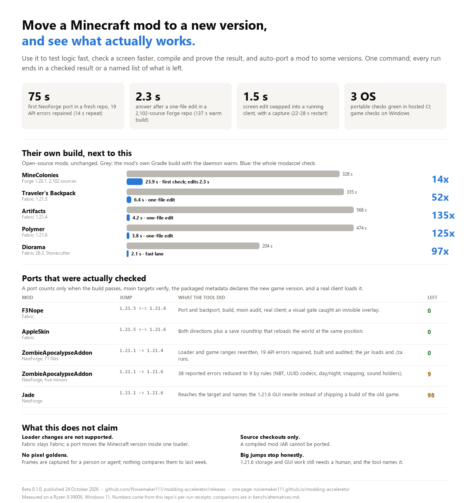

# Modding Accelerator

**Use this to:**

- **Test logic fast.** Compile and run pure tests without launching the game — about a second in a warm repo.
- **Check a screen faster.** Swap the edit into a running client and get a 1280×720 capture in about 1.5 s, against 22–28 s for a restart.
- **Compile and prove a port.** Build, audit mixin targets, check the packaged metadata, then load the result in a real client.
- **Auto-port a mod, on some versions.** Fabric 1.21.5 ↔ 1.21.6 and NeoForge 1.21.1 → 1.21.4 with no hand edits; larger jumps stop with the errors that remain.

Beta 0.1.0, published 24 October 2026 · [download](https://github.com/Noisemaker111/modding-accelerator/releases/tag/v0.1.0-beta.1) · [one-page summary](https://noisemaker111.github.io/modding-accelerator/)



## Goal

Port a mod **from any Minecraft version to any other** — forward, backport, or across
several hops — and **from any loader to any other** (Fabric, NeoForge, Forge, Quilt), starting
from a Gradle source checkout, with fast checks showing what actually works.

Changing the version and changing the loader are separate jobs, recorded separately: a version
port keeps the loader, a loader port keeps the game version, and a mod that needs both is two
steps. Today one hop inside one loader is the verified path; loader changes and multi-hop chains
are the roadmap below, not current capability.

## What works today, and what is next

| Area | Verified today | Next |
|---|---|---|
| One version hop | Fabric 1.21.5 ↔ 1.21.6 ports and backports; NeoForge 1.21.1 → 1.21.4 automatic (75 s first, 14 s repeat) | 1.21.1 → 1.21.6: 9 named errors left (SavedData codec, owner/saddling); then the 1.21.6 GUI rewrite |
| Version chains | A repeated port reuses the same project state | Any version to any other, including multi-hop chains (1.20.1 → 1.21.6) with one record per hop |
| Version families | 1.21.x Fabric and NeoForge; 1.20.1 Forge runs the loop and checks | Older families (1.16–1.19), Quilt, backports across major versions |
| Loaders | Fabric and NeoForge ports end to end; Forge fast lane and checks | Any loader to any loader (Fabric ↔ NeoForge ↔ Forge ↔ Quilt): unbuilt; first step is one small Fabric → NeoForge mod, measured |
| Project shapes | One Gradle project; Stonecutter nodes listed and built | Multi-module orchestration, Stonecutter repairs in shared sources, Kotlin sources |
| Platforms | Game checks on Windows; portable checks on Windows, Linux and macOS in CI | Linux and macOS game rendering |
| Verification | Build, mixins, packaged metadata, real client, inspected captures, `--expect-change`, save roundtrip | Behaviour assertions for items, entities and multiplayer; optional pixel goldens |

The ordered plan is in [`ROADMAP.md`](ROADMAP.md); the current resume point and evidence are in
[`PLAN.md`](PLAN.md).

## Quick start

Download the portable ZIP, check it against the `.sha256`, extract it, then:

```sh
./modaccel support
./modaccel doctor --root "/path/to/mod"
./modaccel port --root "/path/to/mod" --from 1.21.5 --to 1.21.6 --fix
./modaccel fast --root "/path/to/mod"                    # compile + pure tests, no game
./modaccel ui-check --root "/path/to/mod"                # real client, inspected capture
./modaccel world-check --root "/path/to/mod" --world lab # loaded save, optional assertions
```

Windows: `modaccel.cmd`. Any shell: `java -jar modaccel.jar` with the same arguments. Packages
need Java 17+; a Windows machine with none downloads a verified runtime once. To build from
source: `java tools/cli/Bootstrap.java . package --json` with a JDK 17+.

## Limits

- **One hop, one loader.** Loader changes and multi-hop chains are not built yet; the tool says so instead of guessing.
- **Source checkouts only.** A compiled mod JAR cannot be ported.
- **Big jumps stop named.** The 1.21.6 storage and GUI families still need a human, and the receipt lists them.
- **No pixel goldens.** Frames are captured for a person or an agent; nothing compares them with last week.
- **First use costs more.** The first NeoForge port in a repo pays about 40 s of per-project setup.
- **Game checks are verified on Windows.** Linux and macOS run the portable checks in CI, not the game.
- **No AI porting.** It is mapping diffs, typed rules and measured repairs.

## Details and evidence

- [`docs/details.md`](docs/details.md) — portable command internals, older Windows lanes, scenarios, multiplayer, the porting toolbox, measurements.
- [`bench/alternatives.md`](bench/alternatives.md) — sourced comparison with Loom, GameTest, HeadlessMC, MC-Runtime-Test, mc-mod-porter and others, including where they win.
- [`PLAN.md`](PLAN.md) — dated evidence and the current resume point.
- [`ROADMAP.md`](ROADMAP.md) — what's left, in order.
